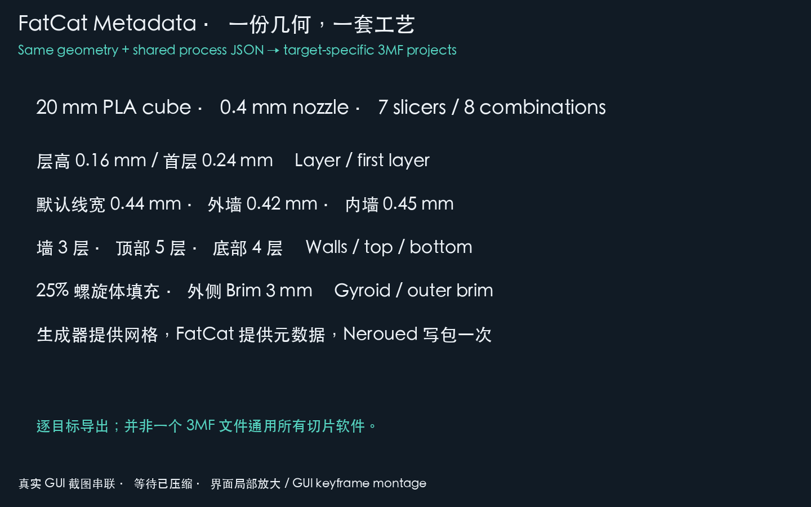
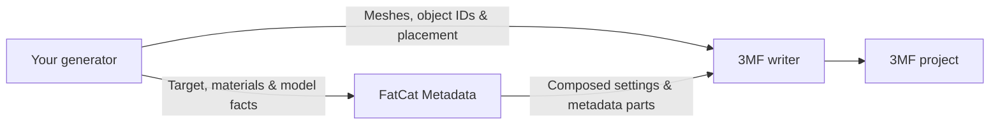
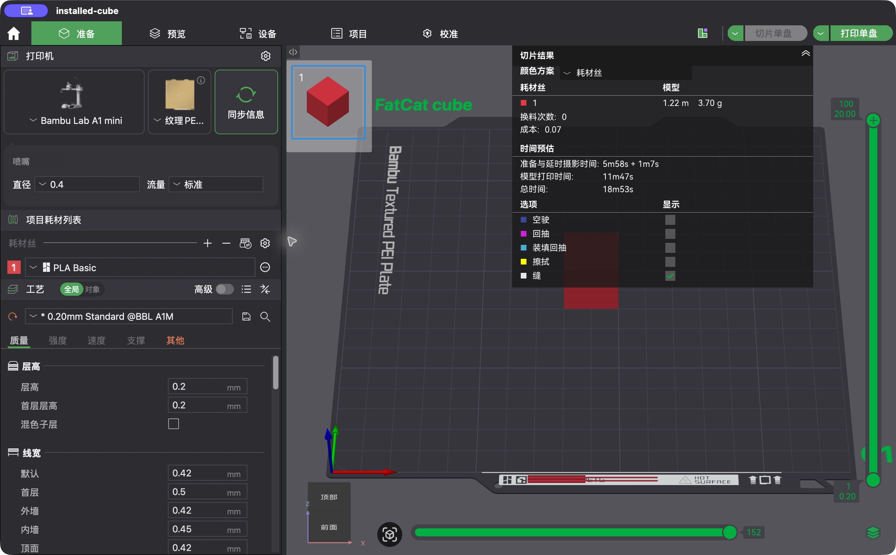

# FatCat Metadata

[](https://github.com/MOVIBALE/fatcat-metadata/actions/workflows/ci.yml)
[](https://pypi.org/project/fatcat-metadata/)
[](LICENSE)


[English](README.md) · [简体中文](README_CN.md) · [First use](docs/FIRST_USE.md) · [API guide](docs/API.md) · [Showcase](docs/SHOWCASE.md) · [Compatibility](docs/COMPATIBILITY.md) · [Issues](https://github.com/MOVIBALE/fatcat-metadata/issues)

**Standalone C++17 and Python slicer settings & 3MF metadata composer for 3D model generators.**

FatCat Metadata resolves native printer, process, and filament profiles from bundled upstream slicer snapshots, merges project overrides and multi-material slots, and outputs the target-specific metadata layout a 3MF writer needs.

## One custom process across seven slicers

One 20 mm test cube and one shared process JSON exported across seven slicers — OrcaSlicer (Bambu A1 mini & P1S), Bambu Studio (P1S), QIDI Studio, ElegooSlicer, Anycubic Slicer Next, Flash Studio, and Snapmaker Orca:



Reproduction commands and per-slicer notes are in [docs/SHOWCASE.md](docs/SHOWCASE.md).

## Architecture



An optional Python adapter for `neroued-3mf==0.4.2` is included (`fatcat-metadata[examples]`), or you can pass the composed metadata dictionary to your own Python or C++ 3MF writer.

## Supported slicers

Bundled offline JSON profile snapshots run without requiring a local slicer installation:

| Application | `slicer_id` | Bundled version |
| --- | --- | --- |
| Bambu Studio | `BambuStudio` | `02.09.01.70` |
| OrcaSlicer | `OrcaSlicer` | `2.4.2` |
| QIDI Studio | `QIDIStudio` | `02.07.02.73` |
| ElegooSlicer | `ElegooSlicer` | `1.5.3.5` |
| Anycubic Slicer Next | `AnycubicSlicerNext` | `2.0.0.6` |
| Flash Studio | `FlashStudio` | `1.7.19` |
| Snapmaker Orca | `SnapmakerOrca` | `2.4.1` |
| PrusaSlicer (preview) | `PrusaSlicer` | `3.0.0-alpha13` |

- **Targets & compatibility:** [`supported-targets.json`](compatibility/current-src/translations/supported-targets.json) and [docs/COMPATIBILITY.md](docs/COMPATIBILITY.md).
- **Process settings:** [docs/PROCESS_SETTINGS.md](docs/PROCESS_SETTINGS.md) (queryable via `fatcat fields --slicer <slicer_id>`).
- **PrusaSlicer 3 preview:** 32 hardware profiles including MK4S, CORE One, MINI, MMU3, and XL multi-tool; see [docs/PRUSA.md](docs/PRUSA.md).

## Installation

### Python (PyPI)

Prebuilt wheels cover 64-bit CPython `3.12`–`3.14` on Windows x64, macOS 14+ (Apple Silicon), and Linux x86-64 (glibc 2.28+):

```bash
python -m pip install --only-binary=:all: fatcat-metadata==0.1.6
# Or with the optional neroued-3mf writer for runnable 3MF examples:
python -m pip install "fatcat-metadata[examples]==0.1.6"
```

To build from source on other platforms (requires a C++17 compiler, CMake 3.18+, and Python 3.12–3.14):

```bash
git clone https://github.com/MOVIBALE/fatcat-metadata.git
cd fatcat-metadata
python -m pip install .
```

### Standalone C++17 SDK

```bash
cmake -S cpp -B build-sdk -DCMAKE_BUILD_TYPE=Release \
  -DFATCAT_BUILD_PYTHON=OFF -DFATCAT_BUILD_TESTS=OFF -DFATCAT_INSTALL_CPP=ON
cmake --build build-sdk --config Release --parallel
cmake --install build-sdk --config Release --prefix /absolute/path/to/fatcat-sdk
```

Link against `FatCatMetadata::Core` in CMake (with `CMAKE_PREFIX_PATH` set to your install prefix and `FatCatMetadata_DATA_DIR` passed at runtime):

```cmake
find_package(FatCatMetadata 0.1.0 CONFIG REQUIRED)
target_link_libraries(my_generator PRIVATE FatCatMetadata::Core)
```

Full C++ build and consumer details are in [cpp/README.md](cpp/README.md) and [cpp/examples/out_of_tree_consumer/](cpp/examples/out_of_tree_consumer/).

## Quick start

### 1. Query catalog choices from the CLI

```bash
fatcat --version
fatcat catalog
fatcat choices --slicer BambuStudio --application-version 02.09.01.70 \
  --machine bambu-lab:a1-mini --nozzle nozzle:0.4mm --plate plate:textured-pei
```

### 2. Compose project settings in Python

```python
import fatcat_metadata as fatcat

result = fatcat.compose_project_settings({
    "project_source": "fatcat_native",
    "slicer_id": "BambuStudio",
    "application_version": "02.09.01.70",
    "machine_uid": "bambu-lab:a1-mini",
    "nozzle_uid": "nozzle:0.4mm",
    "build_plate_uid": "plate:textured-pei",
    "source_materials": [
        {"name": "Bambu PLA Basic", "material_type": "PLA Basic", "colour": "#E63946"}
    ],
})

project = result["project_settings"]
```

Pass `project` and your model's object IDs / filament slots to `fatcat.compose_model_metadata(project, model_request)`.

### 3. Generate a complete `.3mf`

```bash
python -m fatcat_metadata_examples.minimal --output fatcat-cube.3mf
```

<p align="center">
  
</p>

## Documentation & layout

- [First use (`docs/FIRST_USE.md`)](docs/FIRST_USE.md) — CLI discovery and end-to-end 3MF walkthrough
- [API guide (`docs/API.md`)](docs/API.md) — settings composition, model metadata, and material preflight APIs
- [Showcase (`docs/SHOWCASE.md`)](docs/SHOWCASE.md) — seven-slicer custom process exports and reproduction steps
- [Compatibility (`docs/COMPATIBILITY.md`)](docs/COMPATIBILITY.md) — snapshot coverage and historical fallback entries
- [C++ SDK (`cpp/README.md`)](cpp/README.md) & [Maintainers (`docs/MAINTAINERS.md`)](docs/MAINTAINERS.md) — native C++ integration and snapshot refresh workflow

```text
cpp/            C++17 core, public headers, CLI, pybind11 bindings, and examples
python/         Python package surface, type stubs, and optional Neroued adapter
compatibility/  Bundled slicer profile snapshots, indices, and target contracts
scripts/        Snapshot sync utilities and package verification scripts
docs/           Guides, API reference, compatibility notes, and images
licenses/       Third-party profile license texts and source manifest
```

## Contributing & license

Bug reports and pull requests against `main` are welcome via [GitHub Issues](https://github.com/MOVIBALE/fatcat-metadata/issues).

Original FatCat Metadata code is licensed under **AGPL-3.0-only** ([LICENSE](LICENSE), [COPYRIGHT.md](COPYRIGHT.md)). Bundled slicer profiles and third-party libraries retain their respective licenses; see [NOTICE.md](NOTICE.md) and [`licenses/third-party/manifest.json`](licenses/third-party/manifest.json).
