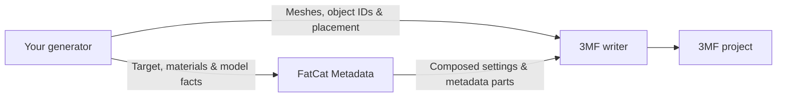

# FatCat Metadata

[](https://github.com/MOVIBALE/fatcat-metadata/actions/workflows/ci.yml)
[](https://pypi.org/project/fatcat-metadata/)
[](LICENSE)


[English](README.md) · [简体中文](README_CN.md) · [First use](docs/FIRST_USE.md) · [API guide](docs/API.md) · [Showcase](docs/SHOWCASE.md) · [Compatibility](docs/COMPATIBILITY.md) · [Issues](https://github.com/MOVIBALE/fatcat-metadata/issues)

**Standalone C++17 and Python slicer settings & 3MF metadata composer for 3D model generators.**

FatCat Metadata resolves native printer, process, and filament profiles from bundled upstream slicer snapshots, merges user-supplied project overrides and multi-material slots, and produces the target-specific metadata layout a 3MF writer needs. Use it from Python (`3.12`–`3.14`) or C++17 in any model generator.

## One custom process across seven slicers

One 20 mm test cube and one shared process JSON exported for eight targets across seven slicers — OrcaSlicer (Bambu A1 mini & P1S), Bambu Studio (P1S), QIDI Studio, ElegooSlicer, Anycubic Slicer Next, Flash Studio, and Snapmaker Orca — customizing layer height, line widths, walls, top/bottom shells, gyroid infill, and brim settings:


Commands and per-slicer notes for reproducing all eight exports are in [docs/SHOWCASE.md](docs/SHOWCASE.md).

## How it fits into a model generator



- **Your generator** builds meshes, assigns material indices, and places objects on plates.
- **FatCat Metadata** selects matching native profiles, resolves profile inheritance, merges process overrides or filament slots, and describes the archive's metadata files, content types, relationships, and root-model annotations.
- **Your 3MF writer** writes the final `.3mf` archive (an optional adapter for `neroued-3mf==0.4.2` is included for Python workflows, or bring your own writer in Python or C++).

## Supported slicers

FatCat ships offline JSON profile snapshots for exact slicer releases, so queries and metadata composition run without requiring a local slicer installation:

| Application | `slicer_id` | Bundled version |
| --- | --- | --- |
| Bambu Studio | `BambuStudio` | `02.09.01.70` |
| OrcaSlicer | `OrcaSlicer` | `2.4.2` |
| QIDI Studio | `QIDIStudio` | `02.07.02.73` |
| ElegooSlicer | `ElegooSlicer` | `1.5.3.5` |
| Anycubic Slicer Next | `AnycubicSlicerNext` | `2.0.0.6` |
| Flash Studio | `FlashStudio` | `1.7.19` |
| Snapmaker Orca | `SnapmakerOrca` | `2.4.1` |
| PrusaSlicer (preview) | `PrusaSlicer` | `3.0.0-alpha13` |

- **Target catalog:** See [`supported-targets.json`](compatibility/current-src/translations/supported-targets.json) and [docs/COMPATIBILITY.md](docs/COMPATIBILITY.md) for machine, nozzle, filament, and build-plate coverage.
- **Process settings:** Normalized cross-slicer process fields are documented in [docs/PROCESS_SETTINGS.md](docs/PROCESS_SETTINGS.md) and queryable via `fatcat fields --slicer <slicer_id>` or `fatcat_metadata.list_native_fields()`.
- **PrusaSlicer 3 preview:** Composes `Metadata/PrusaSlicer3_project.json` across 32 hardware profiles (MK4S, CORE One, MINI, MMU3, XL multi-tool, and more); see [docs/PRUSA.md](docs/PRUSA.md).

## Installation

### Python (PyPI)

Prebuilt wheels are published for 64-bit CPython `3.12`, `3.13`, and `3.14` on Windows x64, macOS 14+ (Apple Silicon), and Linux x86-64 (glibc 2.28+):

```bash
python -m pip install --only-binary=:all: fatcat-metadata==0.1.6
```

To include the optional `neroued-3mf` writer for runnable end-to-end 3MF examples:

```bash
python -m pip install "fatcat-metadata[examples]==0.1.6"
```

To build the Python package from source on other platforms (requires a C++17 compiler, CMake 3.18+, and Python 3.12–3.14):

```bash
git clone https://github.com/MOVIBALE/fatcat-metadata.git
cd fatcat-metadata
python -m pip install .
```

### Standalone C++17 SDK

Build and install the native C++17 library and CLI without Python:

```bash
cmake -S cpp -B build-sdk -DCMAKE_BUILD_TYPE=Release \
  -DFATCAT_BUILD_PYTHON=OFF -DFATCAT_BUILD_TESTS=OFF -DFATCAT_INSTALL_CPP=ON
cmake --build build-sdk --config Release --parallel
cmake --install build-sdk --config Release --prefix /absolute/path/to/fatcat-sdk
```

Consume it in your downstream `CMakeLists.txt` (pointing `CMAKE_PREFIX_PATH` at your install prefix and passing `FatCatMetadata_DATA_DIR` to composition calls):

```cmake
find_package(FatCatMetadata 0.1.0 CONFIG REQUIRED)
target_link_libraries(my_generator PRIVATE FatCatMetadata::Core)
```

Full C++ build and linking instructions are in [cpp/README.md](cpp/README.md) and [cpp/examples/out_of_tree_consumer/](cpp/examples/out_of_tree_consumer/).

## Quick start

### 1. Inspect available machines, plates, and filaments from the CLI

```bash
fatcat --version
fatcat catalog
fatcat choices --slicer BambuStudio --application-version 02.09.01.70 \
  --machine bambu-lab:a1-mini --nozzle nozzle:0.4mm --plate plate:textured-pei
```

### 2. Compose project settings in Python

```python
import fatcat_metadata as fatcat

result = fatcat.compose_project_settings({
    "project_source": "fatcat_native",
    "slicer_id": "BambuStudio",
    "application_version": "02.09.01.70",
    "machine_uid": "bambu-lab:a1-mini",
    "nozzle_uid": "nozzle:0.4mm",
    "build_plate_uid": "plate:textured-pei",
    "source_materials": [
        {"name": "Bambu PLA Basic", "material_type": "PLA Basic", "colour": "#E63946"}
    ],
})

project = result["project_settings"]
```

Pass `project` alongside your model's object IDs and filament assignments to `fatcat.compose_model_metadata(project, model_request)` (or pass an imported user project via `compose_project_settings(source_project, request)`).

### 3. Generate a complete `.3mf` file

With `fatcat-metadata[examples]` installed, write a ready-to-slice `.3mf` in one command:

```bash
python -m fatcat_metadata_examples.minimal --output fatcat-cube.3mf
```

<p align="center">
  
</p>

Follow the step-by-step walkthrough in [docs/FIRST_USE.md](docs/FIRST_USE.md) and the full request/response reference in [docs/API.md](docs/API.md).

## Documentation & repository layout

| Guide | Contents |
| --- | --- |
| [First use (`docs/FIRST_USE.md`)](docs/FIRST_USE.md) | CLI discovery, minimal cube generator, and end-to-end 3MF walkthrough |
| [API guide (`docs/API.md`)](docs/API.md) | Project settings, model metadata, material preflight, and build provenance APIs |
| [Showcase (`docs/SHOWCASE.md`)](docs/SHOWCASE.md) | Seven-slicer custom process exports and reproduction steps |
| [Process settings (`docs/PROCESS_SETTINGS.md`)](docs/PROCESS_SETTINGS.md) | Supported cross-slicer process parameters, types, and aliases |
| [Compatibility (`docs/COMPATIBILITY.md`)](docs/COMPATIBILITY.md) | Profile snapshot notes and historical fallback entries |
| [PrusaSlicer 3 (`docs/PRUSA.md`)](docs/PRUSA.md) | PrusaSlicer 3.0 preview hardware catalog and multi-tool/MMU examples |
| [C++ SDK (`cpp/README.md`)](cpp/README.md) | CMake options, native test suite, and out-of-tree C++ integration |
| [Python consumer examples](cpp/examples/python_neroued_consumer/README.md) | Standalone Python + Neroued 3MF writer examples |
| [Distributions (`docs/DISTRIBUTIONS.md`)](docs/DISTRIBUTIONS.md) | Wheel/SDK packaging, build provenance fields, and PyPI publishing |
| [Validation (`docs/VALIDATION.md`)](docs/VALIDATION.md) & [Maintainers (`docs/MAINTAINERS.md`)](docs/MAINTAINERS.md) | CI test coverage and upstream slicer snapshot refresh workflow |

```text
cpp/            C++17 core, public headers, CLI, pybind11 bindings, and examples
python/         Python package surface, type stubs, and optional Neroued adapter
compatibility/  Bundled slicer profile snapshots, indices, and target contracts
scripts/        Snapshot sync utilities and package verification scripts
docs/           User guides, API reference, compatibility notes, and images
licenses/       Third-party profile license texts and source manifest
```

## Contributing

Bug reports and pull requests against `main` are welcome via [GitHub Issues](https://github.com/MOVIBALE/fatcat-metadata/issues). When reporting a bug, include `fatcat --version`, your OS, the target `slicer_id` and version, machine/nozzle/material/plate IDs, and a minimal reproducer. For updating bundled slicer profiles, follow [docs/MAINTAINERS.md](docs/MAINTAINERS.md).

## License

Original FatCat Metadata code is licensed under **AGPL-3.0-only**; see [LICENSE](LICENSE) and [COPYRIGHT.md](COPYRIGHT.md). Bundled upstream slicer profiles and third-party libraries retain their respective licenses, documented in [NOTICE.md](NOTICE.md) and [`licenses/third-party/manifest.json`](licenses/third-party/manifest.json).
