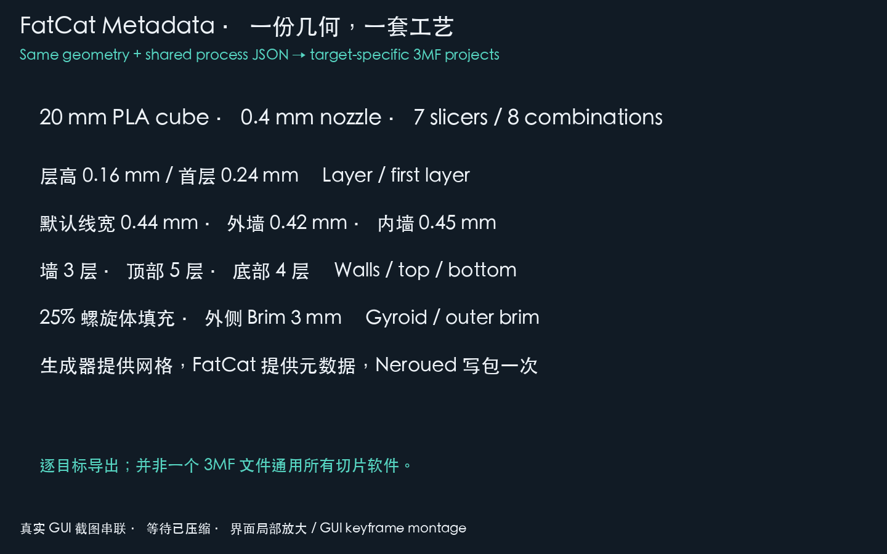
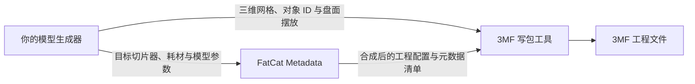
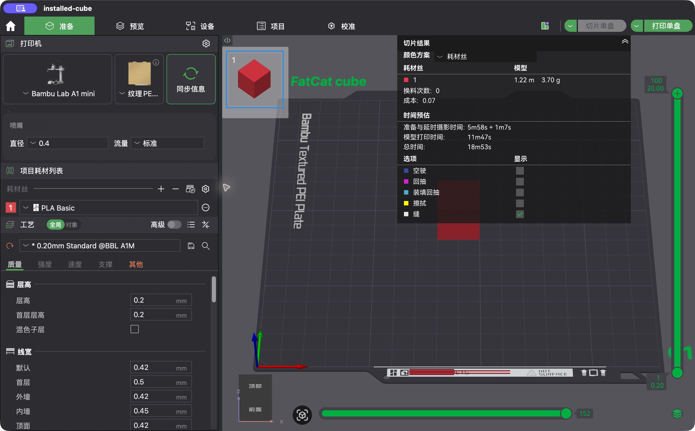

# FatCat Metadata

[](https://github.com/MOVIBALE/fatcat-metadata/actions/workflows/ci.yml)
[](https://pypi.org/project/fatcat-metadata/)
[](LICENSE)


[English](README.md) · [简体中文](README_CN.md) · [快速入门](docs/FIRST_USE.md) · [API 指南](docs/API.md) · [切片演示](docs/SHOWCASE.md) · [兼容说明](docs/COMPATIBILITY.md) · [Issues](https://github.com/MOVIBALE/fatcat-metadata/issues)

**面向 3D 模型生成器的独立 C++17 与 Python 切片参数合成及 3MF 元数据库。**

FatCat Metadata 基于随库内置的上游切片软件配置快照，解析机型、喷嘴、工艺和耗材继承关系，合并自定义工程参数与多耗材槽位，并生成 3MF 写包工具所需的目标切片器元数据结构。

## 同一份自定义工艺，输出到七款切片软件

使用同一个 20 mm 测试方块与同一份工艺 JSON，分别导出覆盖七款切片软件的八组工程 —— OrcaSlicer（Bambu A1 mini 与 P1S）、Bambu Studio（P1S）、QIDI Studio、ElegooSlicer、Anycubic Slicer Next、Flash Studio 与 Snapmaker Orca：



复现命令与各切片软件打开结果见 [docs/SHOWCASE.md](docs/SHOWCASE.md)。

## 工作流架构



Python 环境可选配内置的 `neroued-3mf==0.4.2` 写包适配（`fatcat-metadata[examples]`），也可将合成后的元数据清单传给任意自定义 Python 或 C++ 写包工具。

## 支持的切片软件版本

库内已打包离线原生 JSON 配置快照，查询目录和合成工程无需本机安装切片软件：

| 切片软件 | `slicer_id` | 内置快照版本 |
| --- | --- | --- |
| Bambu Studio | `BambuStudio` | `02.09.01.70` |
| OrcaSlicer | `OrcaSlicer` | `2.4.2` |
| QIDI Studio | `QIDIStudio` | `02.07.02.73` |
| ElegooSlicer | `ElegooSlicer` | `1.5.3.5` |
| Anycubic Slicer Next | `AnycubicSlicerNext` | `2.0.0.6` |
| Flash Studio | `FlashStudio` | `1.7.19` |
| Snapmaker Orca | `SnapmakerOrca` | `2.4.1` |
| PrusaSlicer（预览版） | `PrusaSlicer` | `3.0.0-alpha13` |

- **机型与兼容范围：** [`supported-targets.json`](compatibility/current-src/translations/supported-targets.json) 与 [docs/COMPATIBILITY.md](docs/COMPATIBILITY.md)。
- **跨切片器工艺参数：** [docs/PROCESS_SETTINGS.md](docs/PROCESS_SETTINGS.md)（可通过 `fatcat fields --slicer <slicer_id>` 查询）。
- **PrusaSlicer 3 预览版：** 覆盖 MK4S、CORE One、MINI、MMU3 与 XL 多喷头等 32 组硬件配置，见 [docs/PRUSA.md](docs/PRUSA.md)。

## 安装

### Python（PyPI）

已为 Windows x64、macOS 14+（Apple Silicon）和 Linux x86-64（glibc 2.28+）上的 64 位 CPython `3.12`–`3.14` 发布预编译 wheel：

```bash
python -m pip install --only-binary=:all: fatcat-metadata==0.1.7
# 或连同可选的 neroued-3mf 写包库一并安装以运行完整示例：
python -m pip install "fatcat-metadata[examples]==0.1.7"
```

在其他平台从源码编译安装（需要 C++17 编译器、CMake 3.18+ 与 Python 3.12–3.14）：

```bash
git clone https://github.com/MOVIBALE/fatcat-metadata.git
cd fatcat-metadata
python -m pip install .
```

### 独立 C++17 SDK

```bash
cmake -S cpp -B build-sdk -DCMAKE_BUILD_TYPE=Release \
  -DFATCAT_BUILD_PYTHON=OFF -DFATCAT_BUILD_TESTS=OFF -DFATCAT_INSTALL_CPP=ON
cmake --build build-sdk --config Release --parallel
cmake --install build-sdk --config Release --prefix /absolute/path/to/fatcat-sdk
```

在下游 CMake 工程中指定 `CMAKE_PREFIX_PATH` 并链接 `FatCatMetadata::Core`（运行时传入 `FatCatMetadata_DATA_DIR`）：

```cmake
find_package(FatCatMetadata 0.1.0 CONFIG REQUIRED)
target_link_libraries(my_generator PRIVATE FatCatMetadata::Core)
```

C++ 构建选项与下游接入示例见 [cpp/README.md](cpp/README.md) 与 [cpp/examples/out_of_tree_consumer/](cpp/examples/out_of_tree_consumer/)。

## 快速上手

### 1. 命令行查询机型、打印板与可选耗材

```bash
fatcat --version
fatcat catalog
fatcat choices --slicer BambuStudio --application-version 02.09.01.70 \
  --machine bambu-lab:a1-mini --nozzle nozzle:0.4mm --plate plate:textured-pei
```

### 2. 在 Python 中合成工程配置

```python
import fatcat_metadata as fatcat

result = fatcat.compose_project_settings({
    "project_source": "fatcat_native",
    "slicer_id": "BambuStudio",
    "application_version": "02.09.01.70",
    "machine_uid": "bambu-lab:a1-mini",
    "nozzle_uid": "nozzle:0.4mm",
    "build_plate_uid": "plate:textured-pei",
    "source_materials": [
        {"name": "Bambu PLA Basic", "material_type": "PLA Basic", "colour": "#E63946"}
    ],
})

project = result["project_settings"]
```

将 `project` 与模型对象 ID、耗材槽位映射传给 `fatcat.compose_model_metadata(project, model_request)` 即可获得写包所需的元数据描述。

### 3. 生成完整 `.3mf` 示例

```bash
python -m fatcat_metadata_examples.minimal --output fatcat-cube.3mf
```

<p align="center">
  
</p>

## 文档与目录结构

- [快速入门（`docs/FIRST_USE.md`）](docs/FIRST_USE.md) —— 命令行查询与完整 3MF 导出流程
- [API 指南（`docs/API.md`）](docs/API.md) —— 工程配置合成、模型元数据与耗材预检接口
- [切片演示（`docs/SHOWCASE.md`）](docs/SHOWCASE.md) —— 七款切片软件自定义工艺导出与复现记录
- [兼容说明（`docs/COMPATIBILITY.md`）](docs/COMPATIBILITY.md) —— 配置快照范围与历史回退说明
- [C++ SDK（`cpp/README.md`）](cpp/README.md) 与 [维护指南（`docs/MAINTAINERS.md`）](docs/MAINTAINERS.md) —— C++ 工程接入与配置快照同步流程

```text
cpp/            C++17 核心库、公开头文件、命令行工具、pybind11 绑定与示例
python/         Python 包入口、类型桩与可选 Neroued 写包适配
compatibility/  内置切片软件配置快照、来源索引与目标转换规则
scripts/        配置快照更新与安装包检查脚本
docs/           使用指南、API 文档、兼容说明与演示图片
licenses/       第三方配置文件许可证文本与来源清单
```

## 参与贡献与许可证

欢迎通过 [GitHub Issues](https://github.com/MOVIBALE/fatcat-metadata/issues) 反馈问题或向 `main` 提交 Pull Request。

FatCat Metadata 原创代码采用 **AGPL-3.0-only** 许可证（[LICENSE](LICENSE)、[COPYRIGHT.md](COPYRIGHT.md)）。随库打包的切片软件预设与第三方依赖保留各自许可，详见 [NOTICE.md](NOTICE.md) 与 [`licenses/third-party/manifest.json`](licenses/third-party/manifest.json)。
